# goomui

One HUD for FFXI on **Ashita v4**: party list, target bar, ground rings and an auto-attack chart, drawn in one
look and saved per character.

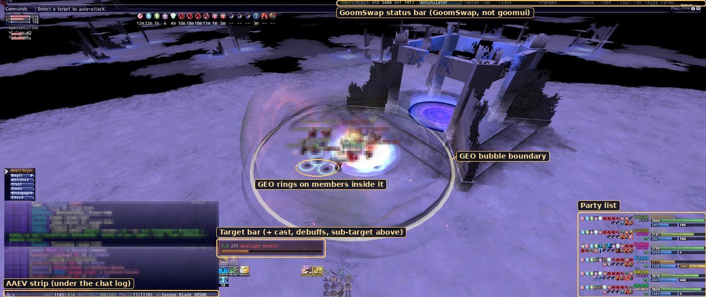

## What it does

| | |
|---|---|
| **Party** | party + alliance list, buff icons in game order, debuffs framed, distance, range dimming, crew recasts on hover |
| **Target bar** | target, sub-target and pet HP; the mob's debuffs with timers (hover: name, time left); cast, item, job ability and menu-recast panels; tint and stripe by target kind |
| **Treasure pool** | a one-line summary by the party list (click for the window): items, time left, each member's lot (high to low, leader gold), passes, who still has to act |
| **Rings** | ground rings under target / sub-target with facing arrow and range fill; a target cursor over the head in your palette colours; GEO bubble rings for your group |
| **AAEV** | auto-attack chart as one line under the chat log (or under the target bar): per-round bars, last round, accuracy, crit, multi-attack (DA/TA/QA) |
| **Look** | one bar style for everything; 30 colour presets; bar shape, texture and frame combine freely; panel styles (Look tab) |

## Screenshots

In game (player names pixelated). Click one for full size; each section's page has more.

<table>
<tr>
<td width="50%"><b>Party list</b> (<a href="docs/party.md">Party</a>)<br>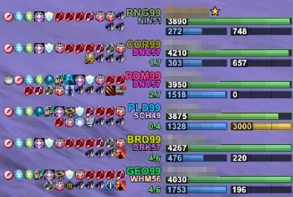<br>Alliance leader + alliance QM (orange name, star, teal box)<br>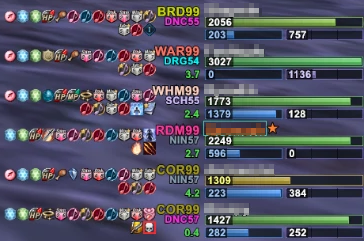</td>
<td width="50%"><b>Crew recasts on hover</b><br>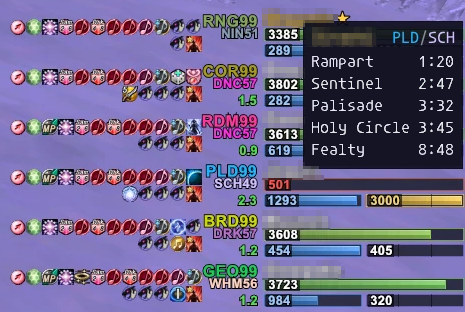</td>
</tr>
<tr>
<td><b>Low-fi rows</b><br>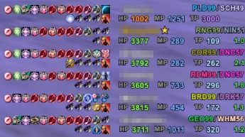</td>
<td><b>Target bar</b> (<a href="docs/bar.md">Target bar</a>)<br>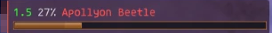<br>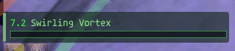<br>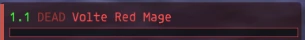<br>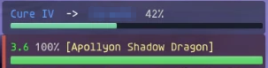</td>
</tr>
<tr>
<td><b>Mob debuffs</b><br>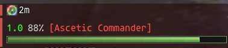</td>
<td><b>Debuff hover</b><br>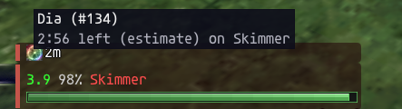<br>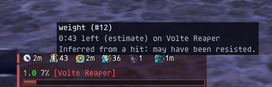</td>
</tr>
<tr>
<td colspan="2"><b>AAEV strip</b> (<a href="docs/aaev.md">AAEV</a>)<br>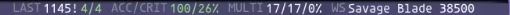</td>
</tr>
<tr>
<td colspan="2"><b>Bar looks</b> (<a href="docs/settings.md">Settings</a>)<br>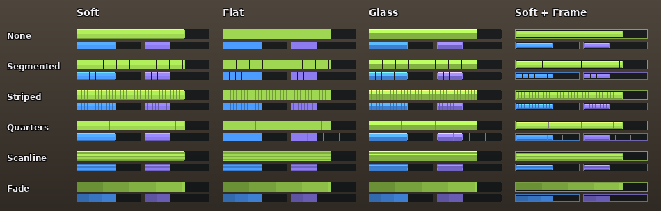<br>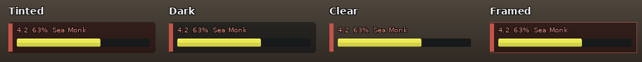</td>
</tr>
<tr>
<td colspan="2"><b>Look tab</b><br>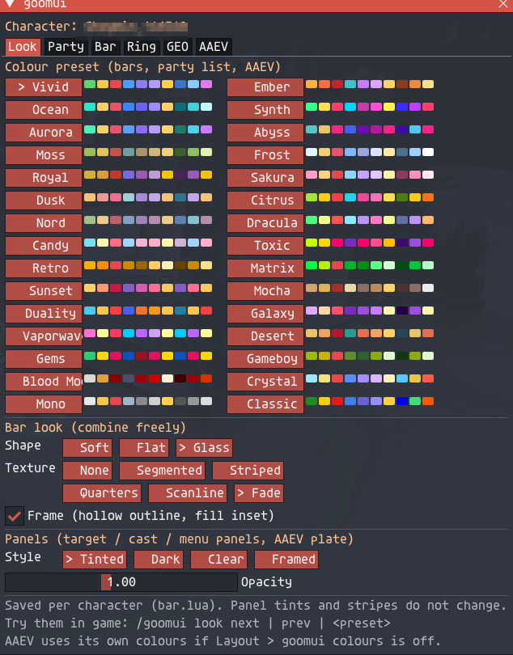</td>
</tr>
</table>

## Install

1. `/addon unload goomui` and `/addon unload targethud` (older versions); `/addon unload customtarget` if you use it
   (goomui draws the target cursor).
2. This repository into `Ashita/addons/goomui/` (folder name must be `goomui`; keep `libs/gdifonts`).
3. `/addon load goomui`

Settings from targethud, targetbar, targetring and AAEV are imported once per character; goomUI 1.6 party settings
are used as they are
([Settings](docs/settings.md)).

## First steps

1. `/goomui` opens the settings window (tabs: Look, Party, Bar, Ring, Cursor, GEO, AAEV). Pick a colour preset in Look;
   *Apply to all characters* sends it to your other characters (MultiSend).
2. **Party:** *Party setup* (or `/goomui setup`) shows drag boxes for the three lists and the list options;
   `/goomui setup` again saves.
3. **Target bar:** Bar tab, uncheck *Lock position*, drag, check it again. The AAEV chart follows it.
4. **AAEV** is off until `/goomui aaev on`; `/goomui aaev demo` shows sample data.

## Commands you'll use most

| Command | Does |
|---|---|
| `/goomui` (`/gui`) | settings window |
| `/goomui setup` | party list setup (drag, options); again = save |
| `/goomui lowfi` | party list text-only mode for this character |
| `/goomui aaev on\|off` | auto-attack chart |
| `/goomui aaev demo` | chart with sample data |
| `/goomui look next\|prev\|<preset>` | try colour presets in game |
| `/goomui ring on\|off` | target rings |
| `/goomui cursor on\|off` | target cursor (styles, colours: Cursor tab) |
| `/goomui geo on\|off` | GEO bubble rings |

[All commands](docs/commands.md).

## Documentation

| Page | What's in it |
|---|---|
| [Party list](docs/party.md) | rows, colours, buffs, low-fi, crew recast hover (with pictures) |
| [Target bar](docs/bar.md) | panels, target kinds, cast / item bar rules |
| [AAEV](docs/aaev.md) | the chart, round colours, stat grid, multi-attack |
| [Rings and GEO](docs/ring.md) | target rings, range fill, target cursor, GEO bubbles |
| [Commands](docs/commands.md) | every command |
| [Settings](docs/settings.md) | files, imports, colour presets, bar look, panels |

## Files

```
goomui.lua            entry: events, commands, settings, imports
modules/theme.lua     palette + bar drawing shared by everything
modules/party.lua     party / alliance list (D3D sprite + gdifonts)
modules/bar.lua       target / cast / JA / menu bars
modules/ring.lua      ground rings, target cursor, GEO bubbles
modules/aaev.lua      auto-attack chart       (modules/aaev_data.lua: message / skill tables)
modules/pool.lua      treasure pool summary and window
modules/action.lua    0x028 action packet parser (rings, AAEV, mob debuffs)
modules/ui.lua        hidden-UI / cutscene / menu state, mouse position
modules/gui.lua       settings window
modules/debuffs.lua   debuff ids for the party list
modules/mobdebuff.lua debuffs on the targeted mob (modules/mobdebuff_data.lua: durations)
libs/gdifonts/        Thorny's gdifonts (party list text)
docs/                 these pages
```

## Something wrong

| Problem | Check |
|---|---|
| Addon unloads with an error | the line number: if it does not match this version, an old file is still in `addons/goomui/` |
| Addon unloads with `EXCEPTION_ACCESS_VIOLATION` (no line number) | `/addon load goomui`: it prints the step that was running when it crashed. Report that line |
| Two party lists | another party list addon still loaded: unload it |
| Party list gone | `/goomui setup` to see the boxes; hidden while solo if *Hide solo* is on |
| Bar and chart overlap other UI | move the bar (Bar tab); the chart moves with it |
| AAEV stat text tiny | widen the bar, or turn off cells (AAEV tab > Stats) |
| Rings vanish with depth test on | `/goomui ring depth` off (no depth surface) |
| Cast bar shows something that did not happen | note the item / spell and what you were doing, and report it |

## Credits

- Party: Tylas (XivParty), Tirem (Ashita port; hide-UI signatures with Velyn), goomUI. MIT: `LICENSE-XivParty`.
- Target bar: aryl (targetbar). Rings: Broguypal (targetring, Windower). Target cursor placement:
  Jyouya (customtarget). AAEV: darkewaffle (Windower).
- atom0s: XiPackets, Ashita SDK, recast / equipmon / crosshair patterns. Thorny: gdifonts, LuAshitacast lookups.
- `modules/debuffs.lua` from XIUI `bufftable.lua`; `modules/mobdebuff.lua` and `mobdebuff_data.lua` from XIUI
  `debuffhandler.lua` / `debuff_retail.lua` (itself from mousseng's XITools). XIUI is GPL-3.0: `LICENSE-XIUI`.
