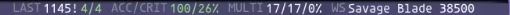

# AAEV (auto-attack chart)

[← Back to the README](../README.md)

Off by default: `/goomui aaev on`. Settings: AAEV tab (Display, Layout, Stats, Weaponskills, Effects, Pet).

## Position

AAEV tab > Layout, *Player chart position*:

| Position | Where |
|---|---|
| **Under chat log** (default) | one line in the gap under the chat log: bars on the left, then every stat cell and the last weaponskill |
| **Under target bar** | flush under the target bar, same x and width, two-row stat grid (move the bar to move both) |
| **Free** | anywhere: `/goomui aaev unlock`, drag, `/goomui aaev lock` |



Under chat log: goomui cannot read the chat log's position, so the strip is placed from settings (Layout tab):

| Setting | Default |
|---|---|
| X, Width | -1 = auto: 0.75% and 30.2% of screen width (fits the default log at 2560x1080) |
| Height | 15px minimum; grows to fit the font |
| Gap to screen bottom | 1px |
| Rounds shown, px per round | last 25 rounds, 5px each |

Strip cells, packed left with 12px between them: `LAST <dmg> <landed>/<swings>`, `AVG`, `ACC/CRIT` (zone-wide
accuracy / crit rate, e.g. `94/29%`), `MULTI` (DA/TA/QA), `WS <last weaponskill> <dmg>`, then MAX / TH / rounds if turned on.
Text shrinks a little to fit the width (not below 85%); if it still does not fit, cells are dropped in this order:
MAX, rounds, TH, AVG, WS. LAST, ACC/CRIT and MULTI always stay. The pet chart (BST, DRG, SMN, PUP) keeps its own window.

## Bars

*One bar per attack round* (default): height = round damage, colour = swings in the round.

| Colour (Vivid) | Round |
|---|---|
| dark blue | 1 swing |
| blue | 2 |
| light blue | 3 |
| lavender | 4 |
| violet | 5+ |
| grey | nothing landed |
| gold cap | the round had a crit |

Other presets use their own family, darker to lighter with more swings: Ember orange, Ocean teal, Synth violet to pink, Aurora green to violet, Abyss blue to pink, Moss green, Frost ice blue to white, Royal purple to gold, Sakura pink, Dusk teal to sand, Citrus lime to orange, Nord blue to purple, Dracula blue to pink, Candy pastels, Toxic purple to lime and pink, Retro amber, Matrix green, Sunset purple to gold, Mocha browns, Duality blue to red, Galaxy violet to starlight, Vaporwave cyan / mint / violet / pink, Desert teal to terracotta, Gems sapphire / amethyst / ruby / amber / gold, Gameboy olive, Blood Moon reds, Crystal ice / wind / earth / lightning / fire, Mono grey; Classic blue / cyan / green / yellow / orange. See [presets](settings.md#colour-presets).

Off: one bar per swing (hit blue, crit gold, miss grey, counter red).

## Stat grid

Two rows under the bars, cells spread across the width:

```
LAST 412!(96) 3/4     MAX 1412     AVG 640     TH 5
ACC 96% (97%)      CRIT 26%      MULTI 24/11/5%
```

| Cell | Meaning |
|---|---|
| `LAST <dmg>[!][(<ae>)] <landed>/<swings>` | last round: melee damage, `!` if the round had a crit, additional-effect damage (enspell, added effect) in brackets, e.g. `412!(96) 3/4`; landed/swings green when all landed, red when none |
| `MAX` / `AVG` | biggest / average round (per swing with one bar per swing) |
| `TH` | Treasure Hunter level seen on this target |
| `ACC <target> (<zone>)` | accuracy on this target; zone accuracy in brackets |
| `CRIT` | crit rate |
| `MULTI` | DA / TA / QA: share of rounds where the main hand swung 2 / 3 / 4+ times |

- **MULTI** (DA / TA / QA) reads the melee result `sub_kind` in 0x028 (0 main hand, 1 off hand, 2 / 3 kicks), per atom0s
  XiPackets `world/server/0x0028`. Off hand and kicks are not counted. Weapons that occasionally attack 2-4 times
  add main-hand swings too, so they show here.
- Cells on / off: AAEV tab > Stats; MULTI: Layout (*DA / TA / QA columns*).
- A row too wide shrinks its text (down to *MinFontScale*); cells never overlap.
- *Stat grid* off: the older label lines.
