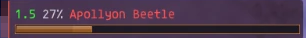
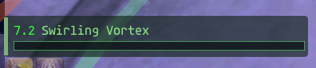
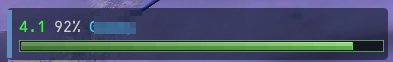
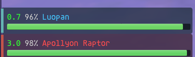
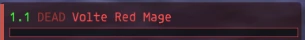
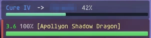
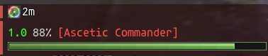
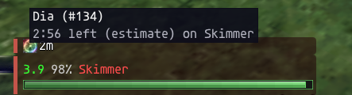
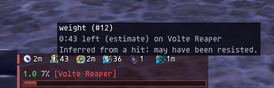

# Target bar

[← Back to the README](../README.md)

Panels stack upward from the bar position: target at the bottom, then the mob's debuffs, pet, sub-target (with its own
debuff row above it), cast, job ability and menu recast above it. The AAEV chart can dock under the target panel (AAEV tab > Layout; default is under the chat log).

Bar tab > *Debuffs below the HP bar* puts each mob's debuff row under its target panel instead (everything else
still stacks upward). A docked AAEV chart then sits under the main target's row.

Bar tab > *Extra panels stack*: **Auto** (default) stacks them upward, or downward when they would not all fit above the
bar (a bar near the top of the screen). **Down** always puts them under the target panel: its debuff row, a docked AAEV
chart, then pet, sub-target (debuffs under it), cast, job ability and menu recast. **Up** is the old behaviour.
*Single bar* shows the target panel only (no pet, sub-target, cast, JA or menu panel).

- **Move:** Bar tab, uncheck *Lock position*, drag the handle, check it again. Or type X / Y.
- **Size:** Bar tab, Width / Height.
- **Shows:** distance (coloured by range, hitboxes counted when *Range colors account for hitbox size* is on),
  height offset (optional), HP %, name coloured by relation / claim.
- **Menu recast:** hovering a spell, ability or mount in the game menus shows its cost and recast. An ability's bar
  fills from the moment goomui saw its recast start (the client holds no full ability recast length); charges for
  Stratagems, Quick Draw and Ready; mounts 1:00 from the summon.

## Target kinds

Each target panel is tinted and has a 5px stripe on its left edge. In game:

| Kind | Stripe |
|---|---|
| Monster | red `#c4544a` |
| NPC | green `#7fb07a` (no HP %, bar left empty) |
| Player (others and you) | blue `#5d8fc2` |
| Your pet | teal `#64b4b4` |
| Sub-target selection active, or a menu hint showing | steel `#7fa3c4` |

Kind comes from the entity spawn flags (`0x01` player, `0x02` NPC, `0x10` monster).

## Mob debuffs

Own panel right above a monster's target panel, growing upward (the other panels sit above it): each debuff tracked
on it, icon and seconds left (`m` / `h` past a minute), in the order they landed (a refresh keeps its place). Hover an icon: its name, time left (m:ss) and the mob, above the cursor. While sub-targeting, the
sub-target's debuffs get their own row above its panel. Each row takes its panel's tint and stripe, with a
gap above it, so a mob's row and panel read as one block. Bar tab:
*Show debuffs on the targeted mob*, *Debuff icon size*.

- The game never sends a mob's debuffs. They are read off packets (XIUI's tracker): **on** from 0x028 (a status-on
  message, or the spell / ability / weapon skill's known duration), **off** from 0x029 (wears off, the mob dies),
  all cleared on zoning (0x00A). Your enfeebling merits and job points (0x08C / 0x08D, sent at login and zoning) lengthen your own.
- Timers are estimates. **`?`** = inferred from a hit (BLU added effect, Weapon Bash, stun WS): the second resist
  roll is not sent.
- Only what happens within packet range is seen; reloading goomui forgets what was on.

## Treasure pool

Shown while the pool has items (Bar tab: *Show treasure pool window*; `/goomui pool demo` for sample items).

- **Summary** (default): one line between the party list and alliance 1, `Pool  8 items  3 to lot  4:31 left  [+]`
  (items, how many you have not acted on, soonest time left, `[+]` / `[-]` = window hidden / shown), framed for a few
  seconds when something drops. It sits in the gap under
  the alliance's last member (full or low-fi lists); with a full alliance (no gap), above the alliance lists. Click it to show or
  hide the window. Off (Bar tab, or `/goomui pool dock`): the window alone, as before.
- **Window:** drag it anywhere off the buttons; the spot is saved. Per item: name, time left, then each member's lot
  high to low (current leader gold, yours green), `pass:` names, and `waiting N` for members in your zone who have
  not acted (names on hover; trusts are not counted, they never lot).

- Buttons: **Lot** (until you act on the item), **Pass** (until you pass), **Lot all** (every item you have not acted
  on), **Pass all** (click twice within 3 s). They send what the game's treasure menu sends (0x041 / 0x042,
  XiPackets `GP_CLI_COMMAND_TROPHY_ENTRY` / `TROPHY_ABSENCE`); the server still decides (full inventory, rare item).
- Items and the current leader are read from memory (Ashita `GetTreasurePoolItem`). Lots and passes come from
  0x0D3 (XiPackets `GP_SERV_COMMAND_TROPHY_SOLUTION`): lot vs pass is read from the roll (negative = pass).
- Time left counts 5 minutes (FFXIclopedia "Treasure Pool") from the 0x0D2 drop goomui saw. Items already in the
  pool when goomui loaded or you zoned in have no timer, and lots made before that are not known (the leader is).

## Cast and item bar

A spell or item you send (0x01A / 0x037) is only *pending*. It becomes a bar when the server echoes the start
(0x028 category 8 for magic, 9 for items) **of the same kind and the same id**: XiPackets 0x0028 gives the spell id
(category 8) or item id (category 9) in the first result's value.

- Driven by the game's cast bar when it moves; otherwise timed from the spell / item cast time.
- **Finished:** when the server sends the finish (0x028 category 4 magic / 5 item, `cmd_arg` = spell / item id) the
  bar fills, reads `done` in green and stays *Hold finished cast / JA* seconds (Bar tab, default 2.5 s). A cast too
  fast to get a bar still shows, as done.
- **Interrupted** (`sp..`, same kind only): the bar stops where it was, turns red, reads `interrupted`, and stays
  the same time.
- A new cast replaces a held one at once.
- Bar full but no matching finish: dropped after 1.5 s.
- Nothing echoed within 2 s of sending: the attempt is dropped, no bar.
- Job abilities show when the server confirms them (0x028 category 6 / 14 / 15), for the same hold time.
