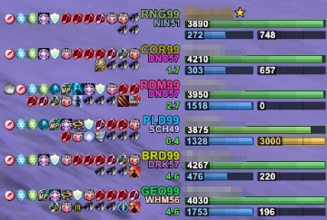
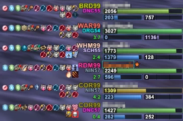
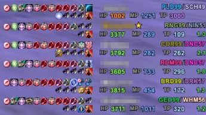
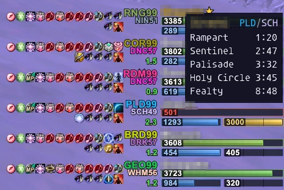

# Party list

[← Back to the README](../README.md)

Party + two alliance lists. Was goomUI 1.6.0 (based on XivParty).

## Setup

Options live on the settings window's *Party list* page (`/goomui`): hide solo / alliance / in cutscenes, distance,
buffs, filters, crew hover, update rate, bar width, text and buff size, cast range, per-list scale, font. Each change
saves right away. Hover (?) for what an option does.

`/goomui setup` (or *Move lists* on that page) shows a drag box per list and opens the page. `/goomui setup` again,
*Done: save positions*, or closing the settings window saves the positions.

- **Move lists together** (default): dragging one moves all three. *Snap alliances above party* re-places them
  (stacked, or side by side with *Snap stacks alliances vertically* off).
- Lists are kept fully on screen.

**Game UI** (Party list page, per character): hide the game's own party list, alliance lists and target frame. Hiding the
target frame also hides the game's target arrow, so goomui's cursor is not doubled. Same method as Ashita's
*hideparty* addon (atom0s); unload hideparty if you use these.

## A row



```
MNK99  Arin
WAR55  [HP 5114 ==============]
  1.3  [MP 415 ====] [TP 3000 ==]
```

| Part | Shows |
|---|---|
| Bars | HP (gradient by %), MP, TP (colour at 1000 / 3000, ticks at 1000 / 2000); theme style |
| Numbers | inside the bars on a dark plate: HP by %, MP light blue, TP white / lavender 1000+ / gold 3000 |
| Name | gold = party leader, orange = alliance leader; green box = quartermaster, teal = alliance QM |
| Jobs | main / sub job in GoomSwap's job colours (same palette as its bar); *Job colours* turns it off |
| Star | drawn star after the leader's name (party gold, alliance orange); *Leader star* |
| Distance | green within cast range (21.8'), yellow to target range (50'), grey beyond; out-of-range rows dim |
| Buffs | game icons in game order, two lines; debuffs framed red, on their own line (*Debuffs on own line*) |



Cast and target range are settings; the defaults come from FFXIclopedia "Distance" and are not checked against
game data. Debuff ids: `modules/debuffs.lua`.

## Low-fi

`/goomui lowfi`: text only, no bars, 250 ms updates, for alts.



`>` before a name = your target, `-` = sub-target.

Hover is opt-in (*Low-fi: allow hover*); crew recasts are still sent.

## Crew recast hover

Load goomui on every box. Each box sends its ability and spell recasts to 127.0.0.1 ports 37810-37817; hover a
member's row to see what is on cooldown.



- Title: name and jobs. Abilities in white, spells in grey; time left in yellow at 10 s or less.
- Only what is still cooling down is listed; nothing = *All ready*. No update for 5 s: *no data for Ns*.
- Wire format `GMU1`: every box needs goomui 2.x (older goomUI boxes are not seen).
- Loopback only; incoming data is checked (size, item count, member name, job ids, finite seconds).
- Boxes silent for 60 s are dropped. `/goomui crew` shows what is seen.

## Buff timers on hover

Hover a buff icon (any row): `Name (#id)`, then time left. *Timers on hover* (Buffs section) turns it off; low-fi
needs *Low-fi: allow hover*.

The game sends timers for your own buffs only; other members' buffs come as ids (XiPackets 0x0076). So:

| Shown | Member | From |
|---|---|---|
| `2:41 left` | you, crew boxes | own timers (as statustimers); crew boxes send theirs with their recasts (`B<id>=<s>`) |
| `~2:41 left` *same cast as Name* | others | a crew box (or you) got the same buff within 2 s (same caster when known): its end time. AoE: songs, rolls, -ra |
| `~2:41 left` *lasts 3:00* | others | the last full length seen on you / a crew box for that buff (that caster's, when seen) |
| *gained 0:40 ago, length unknown* | others | gain seen, nothing learned for that buff yet |
| *time unknown* | others | already on when first seen (addon load, joined, back in zone) |

- Gain time: the id showing up in 0x0076, or a spell / ability landing it (0x028, so refreshes count too). 0x028 only
  arrives in range: a refresh out of range is missed and the estimate runs short (*should have worn off*).
- Lengths vary with the caster's gear, merits and job points: estimates are rough. Learned lengths last until unload.
- Every box needs this goomui version for crew timers. `/goomui bt` lists learned lengths and tracked gains.
