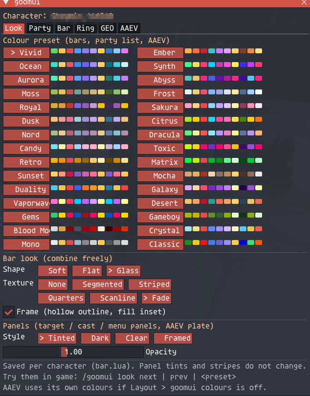
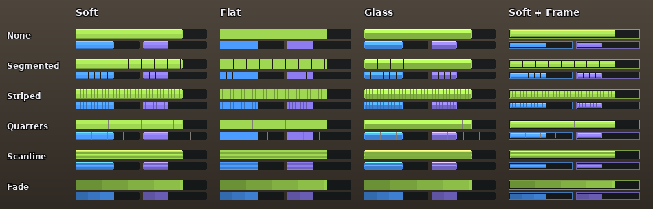
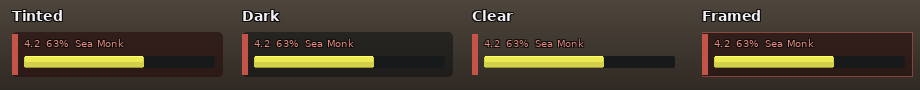

# Settings

[← Back to the README](../README.md)

Use the settings window (`/goomui`); changes save per character as you make them.

## Files

Per character, `Ashita/config/addons/goomui/<Name>_<id>/` (before login: `.../goomui/defaults/`):

| File | Module |
|---|---|
| `settings.lua` | party list (the same file goomUI 1.6 used) |
| `bar.lua` | target bar |
| `ring.lua` | rings and GEO |
| `aaev.lua` | AAEV |

## Imports

Once per character, the first time each file is created:

| Into | Read from (first found) |
|---|---|
| `bar.lua` | `config/addons/targethud/<char>/bar.lua`, else `config/addons/targetbar/<char>/settings.lua` |
| `ring.lua` | `config/addons/targethud/<char>/ring.lua`, else `config/addons/targetring/<char>/settings.lua` |
| `aaev.lua` | `config/addons/targethud/<char>/aaev.lua`, else `addons/aaev/aaev_settings.lua`, `aaev_saved.lua`, `aaev_positions.lua` (also turns AAEV on) |

Only keys that exist in goomui with the same type are copied. The old files are not changed.

## Colour presets

Look tab, one button each with a swatch strip:

| Preset | Feel |
|---|---|
| **Vivid** (default) | saturated green HP, blue MP, purple TP, blue rounds |
| **Ember** | amber HP, teal MP, orange rounds |
| **Ocean** | aqua HP, blue MP, teal rounds |
| **Synth** | neon green HP, cyan MP, magenta TP, violet-to-pink rounds |
| **Aurora** | mint HP, blue MP, violet TP, green-cyan-violet rounds |
| **Abyss** | deep: teal HP, indigo MP, magenta TP, blue-to-pink rounds |
| **Moss** | earthy: olive HP, sage MP, tan TP, green rounds |
| **Frost** | ice: white-blue HP, light blue MP, pale blue-to-white rounds |
| **Royal** | gold HP, purple TP, purple-to-gold rounds |
| **Sakura** | pink HP, sky MP, lilac TP, pink rounds |
| **Dusk** | soft: sand HP, sky MP, lavender TP, muted rounds |
| **Citrus** | lime HP, cyan MP, pink TP, lime-to-orange rounds |
| **Nord** | arctic pastels: sage HP, frost blue MP, purple TP |
| **Dracula** | green HP, cyan MP, purple / pink TP |
| **Candy** | pastels: cyan HP, mint MP, pink TP |
| **Toxic** | acid lime HP, deep purple MP, hot pink TP |
| **Retro** | amber CRT: everything amber, low HP red |
| **Matrix** | terminal green: everything green, low HP red |
| **Sunset** | golden HP, purple MP, pink-orange TP, purple-to-gold rounds |
| **Mocha** | coffee browns: latte HP, cream MP, roast TP |
| **Duality** | ice and fire: cyan HP and MP, red-orange TP, blue-to-red rounds |
| **Galaxy** | deep space: lilac HP, violet MP, starlight TP |
| **Vaporwave** | pink HP, cyan MP, violet TP, cyan / mint / violet / pink rounds |
| **Desert** | sand HP, turquoise MP, terracotta TP |
| **Gems** | emerald HP, sapphire MP, ruby TP, gem rounds |
| **Gameboy** | four-shade olive handheld, low HP red |
| **Blood Moon** | silver HP, dusk-blue MP, blood-red TP and rounds |
| **Crystal** | crystal-blue HP; rounds in the elemental crystal colours (ice, wind, earth, lightning, fire) |
| **Mono** | greys; colour only for low HP, TP 3000, crits |
| **Classic** | the old targetbar / goomUI / AAEV colours |

Try them in game without the window: `/goomui look next`, `/goomui look prev`, `/goomui look <preset>`.

Applies at once to the target bar, cast / menu bars, party list and AAEV chart; saved per character in `bar.lua`
as `theme`. Panel tints, stripes, plates and text do not change. AAEV can use its own colours instead: AAEV tab >
Layout, *goomui colours* off (the `Color*` values in `aaev.lua`).

## Bar look

Look tab, *Bar look*: three independent choices, any colour preset. Saved in `bar.lua` as `bar_style`,
`bar_texture`, `bar_frame`.

| Choice | Options |
|---|---|
| **Shape** | Soft (default): rounded, light upper band, top highlight, dark bottom edge · Flat: square, plain · Glass: rounded, strong shine on the top half, darker bottom half |
| **Texture** | None · Segmented: 10 blocks · Striped: thin dark ribs · Quarters: marks at 25 / 50 / 75% · Scanline: dark line every 2px · Fade: fill darkens toward the empty end |
| **Frame** | on: hollow 1px outline in the fill colour, fill inset 2px |

Commands: `/goomui look shape soft|flat|glass`, `/goomui look texture none|segmented|striped|quarters|scanline|fade`,
`/goomui look frame [on|off]`. Applies to the target, cast, menu and party bars; the AAEV chart keeps its own bars.
Characters saved with a 2.0 style keep it: Segmented → Soft + Segmented, Striped → Flat + Striped,
Outline → Flat + Frame.

## Panels

Look tab, *Panels*: the plates behind the target, cast, JA and menu panels and the AAEV chart. Saved in `bar.lua` as
`panel_style` and `panel_alpha`.

| Style | Plate |
|---|---|
| **Tinted** (default) | dark plate tinted by target kind |
| **Dark** | one dark plate for every kind |
| **Clear** | faint neutral plate (no kind tint); the kind stripe stays |
| **Framed** | tinted, with a 1px frame in the kind colour |

*Opacity* (0.25 - 2) scales the plate. Commands: `/goomui look panel tinted|dark|clear|framed`,
`/goomui look opacity <0.25-2>`. The kind stripe always shows.
